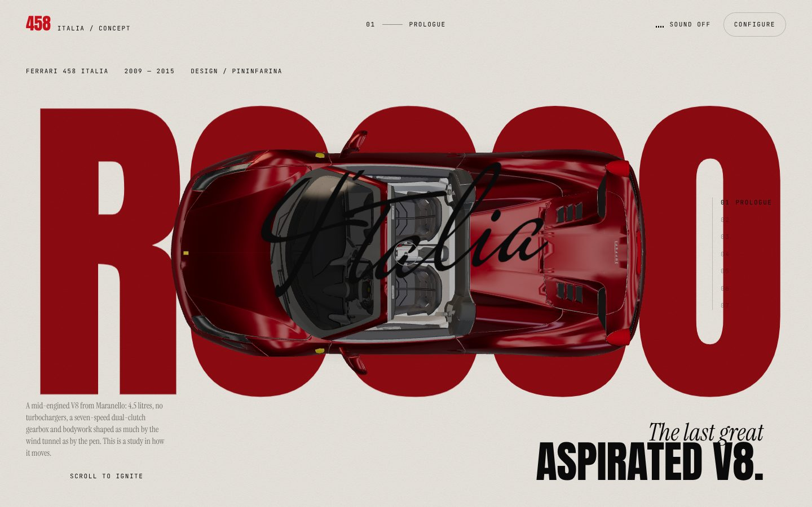
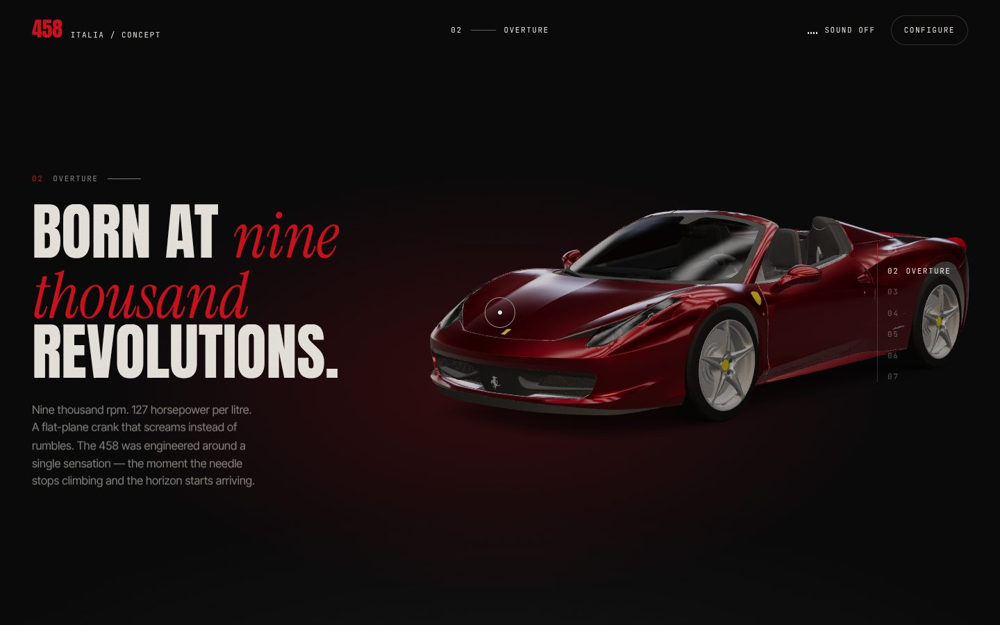
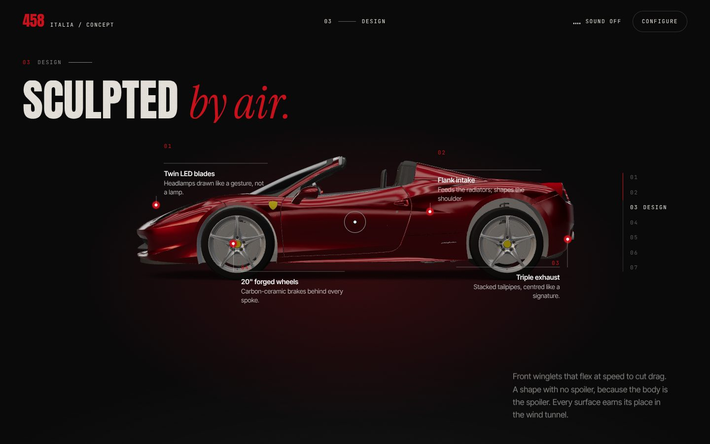
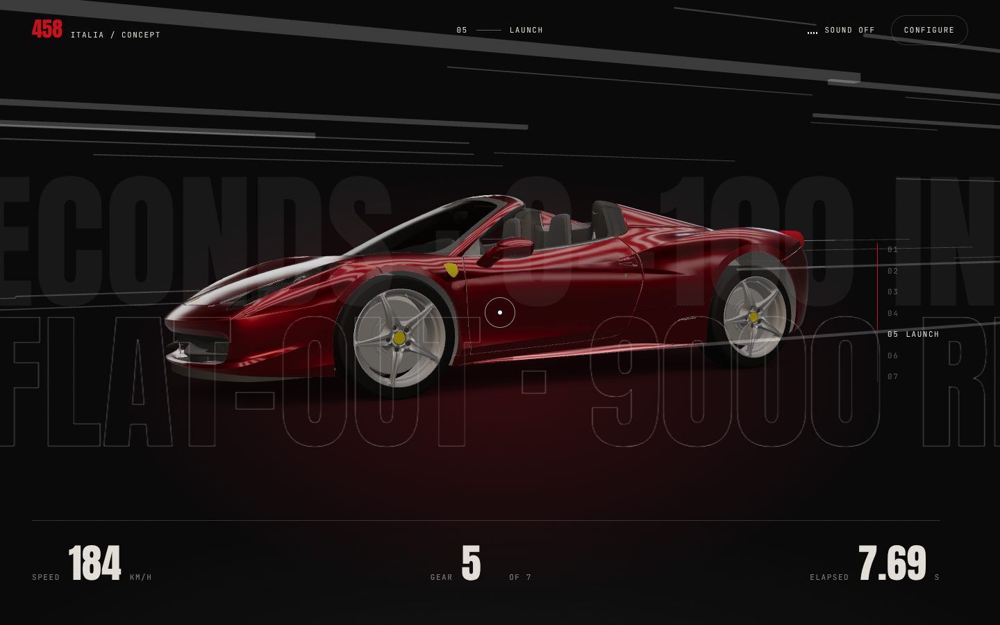
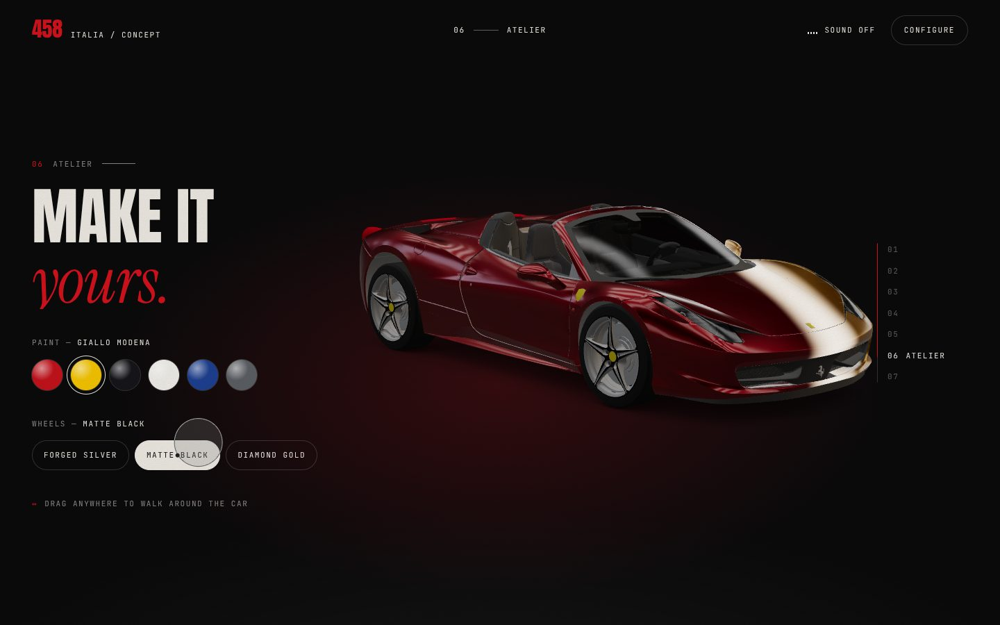
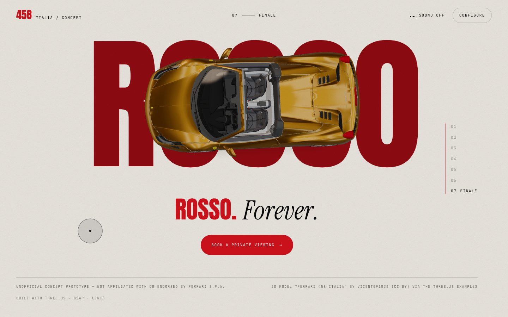
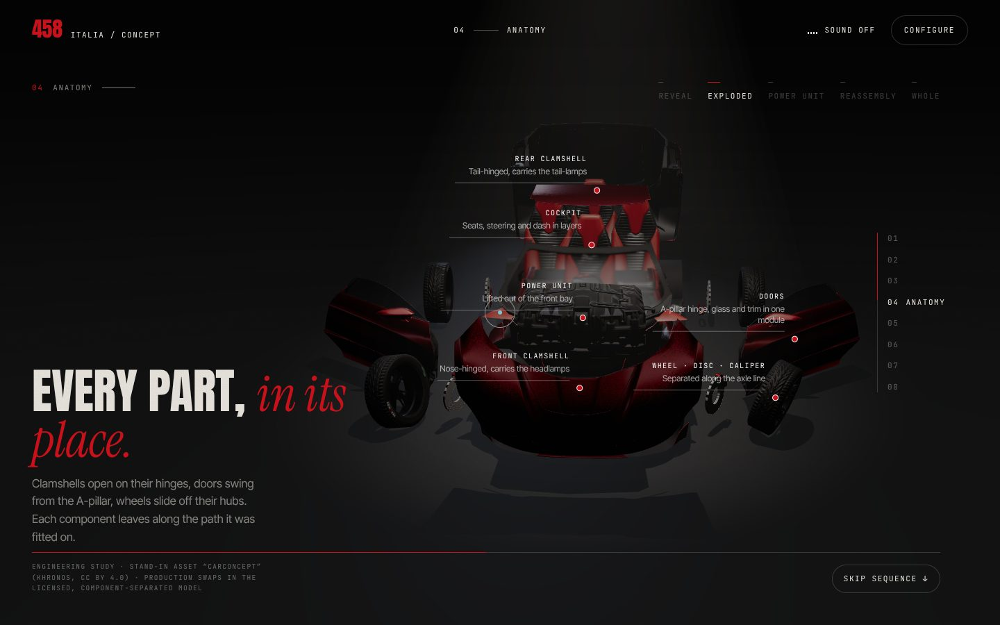
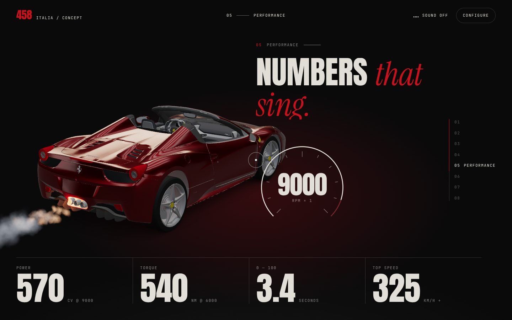

# Rosso — 458 Italia, a 3D scroll experience

An unofficial, pitch-ready concept: a premium car website built around a real-time 3D Ferrari 458 Italia.
See [RESEARCH.md](./RESEARCH.md) for the design research, roadmap and pitch demo script.

| | |
|---|---|
|  |  |
|  |  |
|  |  |
|  |  |

## Run

```bash
cd ferrari-3d
npm install
npm run dev        # http://localhost:5173
npm run build      # outputs dist/ (relative paths, works offline from any static server)
npm run preview
```

Append `?snap` to the URL to turn off camera damping (useful for screenshots).

## Structure

```
index.html            chapters (DOM copy, hotspots, HUD, configurator)
src/main.js           boot, loader, Lenis + GSAP, camera keyframes per chapter, all chapter interactions
src/experience.js     three.js scene: studio env map, materials, paint-sweep shader, streaks, hotspot projection
src/engine-sound.js   procedural Web Audio V8 driven by rpm
src/cinematic/        the Anatomy chapter: exploded-view cinematic
  manifest.js         part manifest: which nodes move, on which hinge, in which order
  exploder.js         poses the manifest for any explode value (pure function → exact reversal)
  anatomy.js          stage: lighting, fog, shadows, camera path, beats, power-unit FX
src/fx/
  exhaust.js          tailpipe exhaust particles + pulse light (one Points draw call)
  heat-haze.js        screen-space heat shimmer pass (bypassed when idle)
src/style.css         design tokens, typography, layout, responsive rules
public/models         Draco-compressed glTF: ferrari.glb (+ AO), concept-car.glb (Anatomy stand-in)
public/posters        static image used when WebGL is unavailable
public/draco          Draco decoder
```

## Tuning the camera

Each chapter has a keyframe in `keyframes()` in `src/main.js`:
`az` (azimuth°), `el` (elevation°), `dist`, `fov`, target `tx/ty/tz`, car yaw `rot`, horizontal framing `shift`
and `roll`. The camera blends to the next keyframe while the next chapter slides in, then holds while its
copy is read. Portrait screens get their own values.

## Anatomy: the exploded-view cinematic

Chapter 04 is a pinned, scroll-driven film in five beats:

| Progress | Beat | What happens |
|---|---|---|
| 0.00–0.20 | Reveal | Starts in near darkness. Key light, fog beam and a travelling side light bring the car up; the camera orbits from front ¾ to side. |
| 0.20–0.54 | Exploded | Lamps float out, clamshells open on their real hinges, doors swing from the A-pillar, roof and glass lift, wheels slide off their hubs (disc and caliper stop halfway), the power unit lifts out, axles drop, and cockpit parts rise in layers. Callouts are pinned to the parts. |
| 0.54–0.72 | Power unit | The camera closes on the lifted unit. A warm bay light pulses in an uneven, firing-like rhythm, with micro-vibration and heat shimmer. |
| 0.72–0.88 | Reassembly | The same paths in reverse order: clamshells and doors close, and every part lands on its stored rest transform. |
| 0.88–1.00 | Whole | Hero orbit, then a fade to black into Performance. |

**How it stays smooth and reversible:** the page does the pinning (a tall section with sticky content, so
there's no scroll hijack). Section progress is the only input, damped once, and every pose is a pure function
of it. Scrolling up replays the film backwards, and at explode = 0 each node is restored from its stored rest
transform (verified at under 1e-12 after a full round trip). The cinematic renders through the site's existing
WebGL renderer: while it's on screen the main scene sleeps, and a black curtain covers each hand-over.

**Asset honesty:** the 458 model in this repo is split by material, not by component (the whole body is one
mesh, and there's no engine), so it can't be exploded truthfully. The Anatomy chapter therefore uses a clearly
labelled stand-in, Khronos' **CarConcept** (CC BY 4.0). It has real separate components and pivots: a front
clamshell hinged at the nose, a rear clamshell hinged at the tail, A-pillar door hinges, a removable roof
panel, a power unit, axles, wheel/disc/caliper stacks, seats, steering and dash. It was optimised from 11.8 MB
to 1.6 MB, hierarchy intact:

```bash
npx @gltf-transform/cli optimize CarConcept.glb public/models/concept-car.glb \
  --compress draco --flatten false --join false --instance false --palette false --simplify false \
  --texture-compress webp --texture-size 1024
```

That asset has **no tailpipes**, so the cinematic shows no combustion exhaust (the manifest's `exhaust` is empty
on purpose). The exhaust sequence runs on the 458 instead, which does have three real tailpipes: it fires in
Performance (revving to the limiter, rear ¾ view) and Launch (a pulse on every upshift, with the plume swept
back by the airflow).

**Swapping in the production model:** export the licensed, component-separated 458 (or any car) as glTF with
one node per component and pivots at the real hinges and hubs. Then write a manifest like
`src/cinematic/manifest.js`: node names, hinge axis and angle, move vector, window. If the asset has an engine
and exhaust, set `focus` and `exhaust`. Unknown node names are reported in the console, and nothing else needs
to change.

**Fallbacks:** the model lazy-loads in idle time after the main car, or as soon as the visitor reaches Design,
whichever comes first, with progress shown if they arrive early. `prefers-reduced-motion` drops vibration,
pulses and shimmer and halves the particles. Without WebGL the site runs as a static page and Anatomy shows a
poster of the exploded view.

## Credits

3D model "Ferrari 458 Italia" by vicent091036 (via the three.js examples). Anatomy stand-in: "CarConcept" by
Eric Chadwick, Darmstadt Graphics Group (CC BY 4.0), from the Khronos glTF Sample Assets, with its Khronos logo
plate and emblem hidden. Unofficial concept; not affiliated with or endorsed by Ferrari S.p.A.
