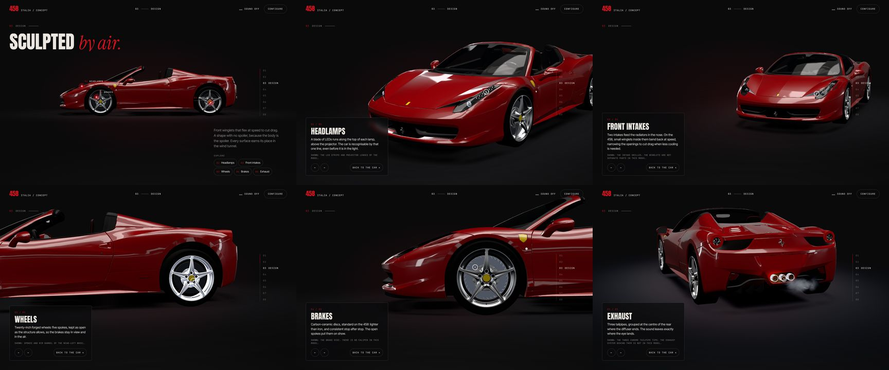
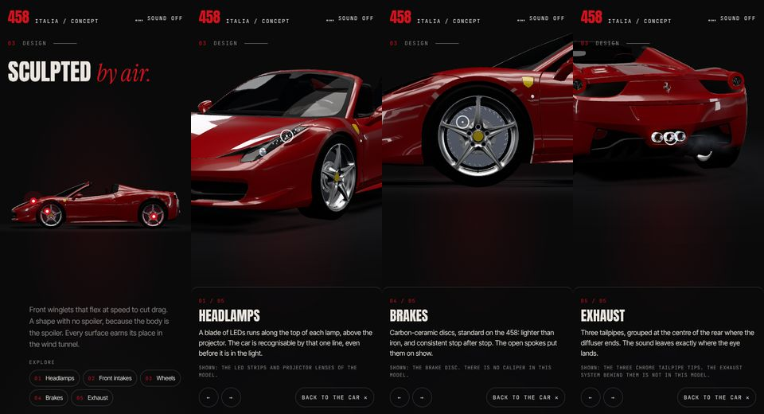

# Design chapter: exploring the car

Code: `src/design/features.js` (what can be explored), `src/design/explorer.js`
(states, camera, markers, panel), `src/design/highlight.js` (component
highlight), `src/ui/labels.js` (label layout, shared with the Anatomy
annotations). The wiring is `designChapter()` in `src/main.js`.

Overview, then each feature open (1440×900), and on a phone (390×844):

## What can be explored

Every feature is a real component of the main car's model (`ferrari.glb`, registry
`ferrari-458`). It is addressed by registry ID, never by mesh name.

| # | Feature | Marker on | Highlighted | In this model |
|---|---|---|---|---|
| 01 | Headlamps | Left LED strip | Both LED strips (the side-mirror LEDs are excluded) and both projector lenses. The daytime-running-light emission is turned up | LED strip and projector lens are separate parts |
| 02 | Front intakes | Left front intake grille | Both front intake grilles | One mesh holds every grille on the car (front, rear deck, tail), so a car-space box limits the highlight to the nose. There are no winglets as separate parts |
| 03 | Wheels | Spoke face of the rear-left wheel | Its spokes and rim barrel | The wheel turns with scroll speed, and the highlight turns with it |
| 04 | Brakes | Upper half of the front-left disc | The disc | Discs only; the asset has **no calipers** |
| 05 | Exhaust | Centre of the three tailpipe tips (registry anchors) | The tips only: one mesh holds all chrome, so a box limits it. The existing exhaust effect gives one short puff | Only the chrome tips exist; there is no exhaust system |

The panel's mono note states each feature's model limit.

## Interaction

- **Overview** (while the chapter is on screen):
  - Numbered markers sit on the car. On desktop each marker has a short label.
  - An *Explore* index sits under the chapter copy.
  - Hovering a marker or index item, or focusing an index item, previews the
    highlight.
- **Open a feature** (click or tap a marker, or activate an index item):
  - The camera blends from where it is to that feature's view (1.35 s,
    power3.inOut; 1.1 s from one feature to the next).
  - The component lights up: a fresnel rim glow, plus one band of light that
    sweeps across it.
  - The panel shows the number, title, two-sentence editorial text and the
    model note, with Previous, Next and *Back to the car*.
  - Other markers hide, the open feature's marker becomes a ring, and the page
    is held still.
- **Back to the car:**
  - Ways out: the *Back to the car* button, `Esc`, any scroll (wheel, touch
    drag, scroll keys), a click or tap outside the panel, or leaving the chapter.
  - The camera blends back to the chapter's own view, normal damping returns,
    and scroll resumes where it was.
  - If the panel had keyboard focus, focus returns to the index item that
    opened it.
- **Keyboard:** the index items are buttons with `aria-pressed`. `Enter` opens a
  feature and moves focus into the panel, `←` and `→` step through the features
  (wrapping), and `Esc` closes. The markers are a pointer and touch shortcut to
  the same index, so they are hidden from assistive technology and left out of
  the tab order.
- **Touch:** each marker has a 44 px target. On phones the panel is a bottom
  sheet and the camera frames the feature above it.
- **Reduced motion:** the camera cuts instead of flying, and there is no light
  sweep and no exhaust puff.

## How it stays aligned and out of the way

- **One scene.** There is no second car or camera. The explorer proposes a rig to
  the main frame loop (`design.apply(rig)`), which owns the camera. While a blend
  runs, the rig follows the tween exactly. At the end it lands on exactly the
  chapter's rig, never 360° off, so normal damping takes over without a spin.
- **Alignment.** Markers are projected after every rendered frame
  (`exp.onFrame`), using the camera of that frame, from a vertex on the
  component itself. They stay on the part through every camera move and as the
  wheel turns.
- **Occlusion.** Each feature has the direction it faces. A marker hides once
  that direction turns away from the camera, which is when the car's own body
  hides it (for example the exhaust in the side view). It shows when facing past
  0.25 and hides below 0.18, so it doesn't flicker. This avoids per-frame
  raycasts against 350k triangles. A marker is either fully shown and clickable
  or hidden, never half-faded. Features hidden this way stay reachable from the
  index.
- **Typography.** The chapter headline, copy, index, the open panel and the
  navigation are exclusion zones. A marker that would land on them hides, and
  labels are lifted clear of them. In a detail view the headline and copy step
  aside, because the panel carries the title, so the car is never seen through a
  headline.
- **Label collisions.** Labels sit beside their marker. Where two would overlap
  they are lifted on leader lines, easing rather than jumping (the same layout
  as the Anatomy annotations).
- **Camera framing.** Each view fixes angle and lens. The distance is solved by
  `fitDistance` from the feature's measured bounds for the current screen. On wide
  screens the subject sits right of the panel; on tall screens it sits above the
  sheet.

## Fixes found on the way

- Lenis's stylesheet sets `overflow: clip` on the root while scrolling is
  stopped. That stops `body`'s `overflow-x` from passing to the viewport, so
  `body` becomes its own scroll container and every sticky chapter un-sticks (the
  Design panel jumped up a third of the screen). Lenis already cancels wheel and
  touch input while stopped, so the root is now left unclipped.

## Tests (browser, software renderer)

All of these were run in headless Chromium against the dev server
(`scratchpad/ds/behave.cjs`). Every one passed.

| Test | Result |
|---|---|
| Real pointer click on every marker visible in the overview (headlamps, wheels, brakes at 960×600) | Each opens its feature: camera at the view, component lit, panel with the right title, page held |
| Features hidden in the overview (front intakes, exhaust, turned away from the side view) | Open from the index, and their marker shows at the feature |
| No half-visible markers | Every marker shown is fully opaque and clickable |
| Alignment during camera moves | Marker position matches a fresh projection of its 3D point within 0.06 px, over 24 frames sampled mid-flight |
| Exits: *Back to the car*, `Esc`, mouse wheel, click outside | Each returns to the car with the page where it was. The camera ends back on the chapter view (≤ 0.004 deviation) and scrolling works again |
| Keyboard | `Enter` on an index item opens it and moves focus into the panel. `→` steps through all five and wraps, `←` steps back. `Esc` closes and focus returns to the index item. `aria-pressed` reflects state |
| Layout at 1440×900 and 960×600 | No marker or label on the headline, copy, index or navigation, and no label collisions |
| 8 open/close cycles, half interrupted mid-flight | End clean: camera on the chapter view, no highlight left on, page released, normal damping back |
| Reduced motion | The camera cuts to the feature |
| Phone (390×844, touch) | Every visible marker opens on tap. The detail shows as a bottom sheet. *Back* and tapping outside both close it |
| Console | No errors or warnings in any run |

**Performance:** while a feature is open, the highlighted meshes are drawn once
more with the highlight shell. Nothing extra is drawn in the overview (shells
are hidden at zero intensity). Each frame, projecting the five markers costs a
handful of vector operations and four `getBoundingClientRect` reads. Frame rate
on a real GPU was not measured: the session only had a software renderer.
