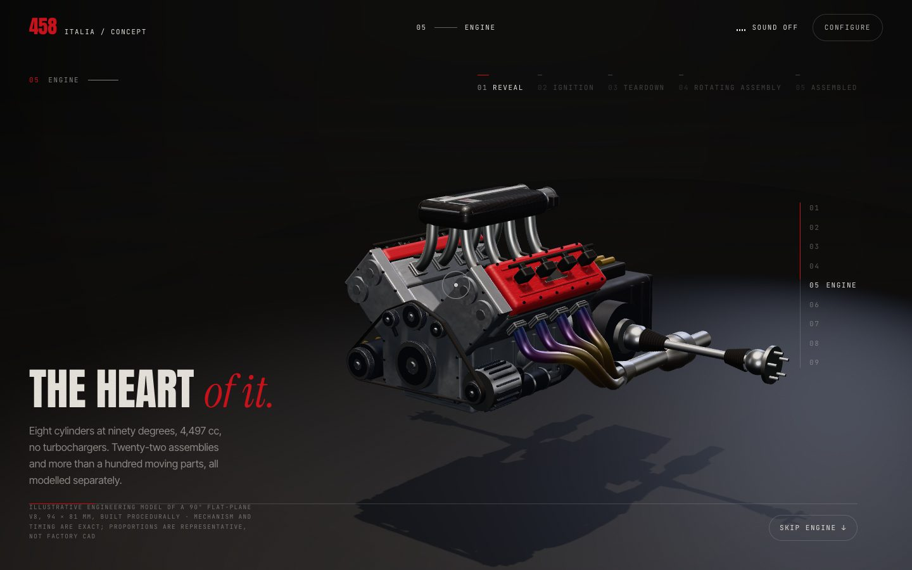
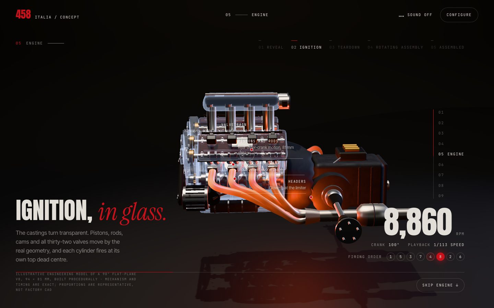
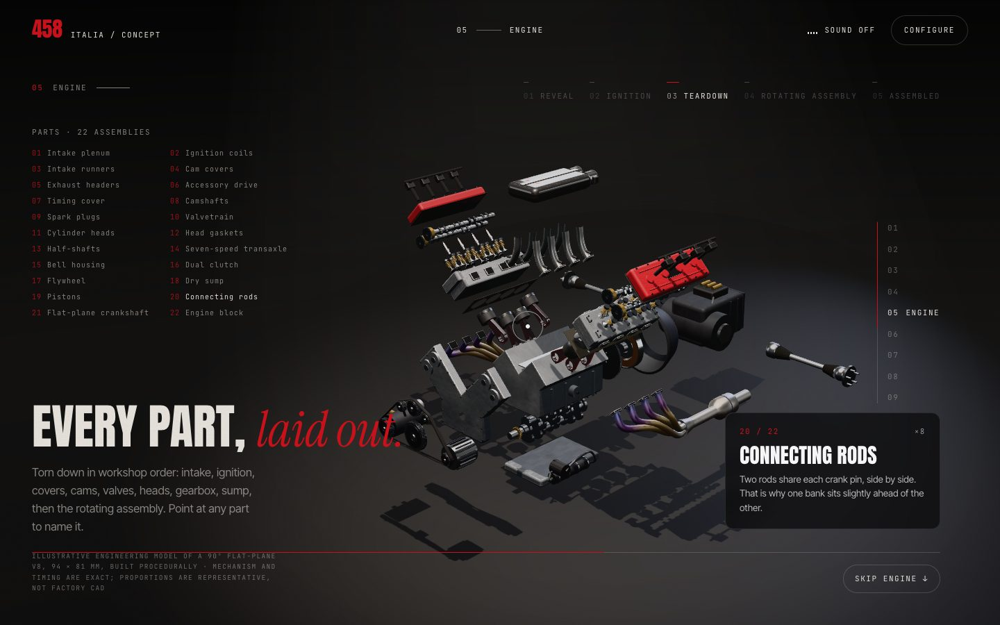
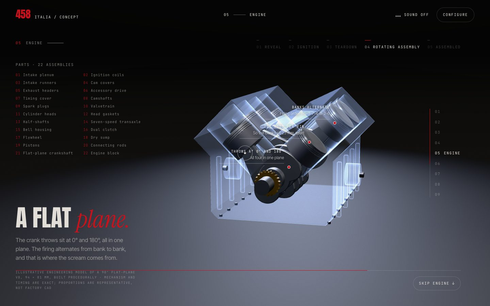
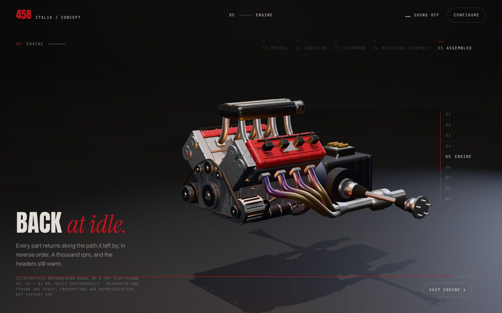
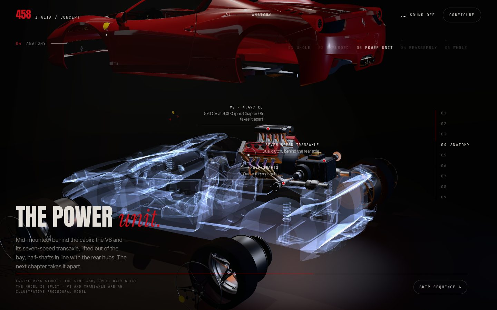

# Engine: the V8, running and taken apart

Code: `src/engine/v8.js` (the engine: geometry, kinematics, posing, x-ray,
highlight), `src/engine/materials.js` (procedural finishes, heat tint, x-ray
shell), `src/engine/timeline.js` (states, channels, camera keys, annotations),
`src/engine/stage.js` (studio, lights, camera, picking), and the wiring in
`src/main.js` (`engineChapter`, `engineFrame`, `goToEngineState`).

| | |
|---|---|
|  |  |
|  |  |
|  |  |

## Why the engine is procedural

The 458 model has no engine: it is split by material, and its body is one
mesh (see `docs/ASSETS.md`). No licensed,
component-separated engine asset was available, so the engine is built in code
from its specification: 22 assemblies with more than 120 moving parts, every
one a separate node with its own pivot. It downloads nothing (about 40 KB of
code) and is built in idle time.

Because it is built from the specification, the **mechanism is exact**, even
though the proportions are representative rather than factory CAD (the chapter
says so in its credit line):

- **Slider-crank kinematics** for all eight pistons and rods: bore 94 mm,
  stroke 81 mm, rod 150 mm, banks at ±45°, two rods side by side on each pin
  (hence the 23 mm bank offset).
- **Flat-plane crank** (pins 0°/180°/180°/0°). The firing order 1-5-3-7-4-8-2-6
  is checked at build time: each cylinder must fire at its own top dead centre,
  or the console warns. A 720° sweep reads 1@315°, 5@405°, 3@495°, 7@585°,
  4@675°, 8@45°, 2@135°, 6@225°: one cylinder every 90°, alternating bank to bank.
- **Valvetrain:** four cams at half crank speed. Every lobe is phased to its
  cylinder's firing angle, and the lobe *profile* is the valve-lift curve, so
  each valve opens exactly while its lobe is on the tappet. Pent-roof chambers:
  valves are inclined 12° each side of the bore axis, and springs compress with lift.
- **Accessory drive:** pulleys turn at their real ratios to the crank; the belt
  follows the convex hull of the pulleys.

## Parts (teardown order)

Intake plenum (carbon, twin throttles, cast badge) · ignition coils ×8 · intake
runners ×8 · cam covers ×2 (crinkle red) · exhaust headers ×2 (4-into-1, heat
tint) · accessory drive · timing cover · camshafts ×4 · spark plugs ×8 ·
valvetrain ×32 (valve, spring, bucket tappet; instanced) · cylinder heads ×2 ·
head gaskets ×2 (MLS, with bore and coolant holes) · half-shafts ×2 (CV joints
and boots) · seven-speed transaxle · bell housing · dual clutch · flywheel
(toothed ring) · dry sump (pan, scavenge pump, filter, braided lines) · pistons
×8 (rings, coated skirts, pins) · connecting rods ×8 (cap bolts) · flat-plane
crankshaft (counterweighted webs, sprocket) · block (liners, ribs, mounts).

## States

One timeline, indexed by a playhead `q` (0..1) that follows the section's
scroll progress. Control works exactly as in Anatomy (`SequenceController`, now
shared and given the chapter's own state list): scroll *or* a state button,
never both. Everything is a pure function of `q` except the crank angle, which
is integrated from a speed that is itself a function of `q`, so a held state
keeps running.

| # | State | Anchor | What happens |
|---|---|---|---|
| 1 | Reveal | q 0.08 | Lights come up on the assembled engine |
| 2 | Ignition | q 0.35 | Castings turn to glass (0.13–0.20). Starter, catch, idle, rev to 9,000 and the limiter. Combustion flashes in firing order, headers glow, heat haze rises from the collectors. The dyno HUD shows rpm, crank angle, the slow-motion ratio and the firing cylinder |
| 3 | Teardown | q 0.63 | Every part leaves on its own path in workshop order (0.44–0.58), then pistons and rods come up out of the bores and the crank drops (0.53–0.62). Point at any part, or use the parts list |
| 4 | Rotating assembly | q 0.79 | The torn-down parts retreat and shrink away. Crank, rods and pistons go back into a glass block and are turned slowly by hand |
| 5 | Assembled | q 0.96 | Everything returns in reverse order. Idle, headers still warm |

**Slow motion, labelled.** 9,000 rpm is 150 rev/s, which can't be read on a
60 Hz screen, so the mechanism plays at 0.4–1.35 rev/s, like footage from a
high-speed camera, and the HUD prints the ratio (about 1/110 at the limiter).
The engine sound (if on) plays the real rpm.

**Collision-free by construction.** Explode windows are ordered so that no part
moves through another: outer parts leave before the parts beneath them, and
each part travels at least as far as the parts it was covering (coils before
covers, cams before valves before heads before gaskets, pistons only once the
gaskets are clear, sump and flywheel before the crank drops). Reassembly is the
same windows in reverse.

## Inspection

- **Desktop:** pointing at a part highlights it (a Rosso fresnel shell) and
  shows its card: index, quantity, name and a line on what it does. Picking
  ignores the glass castings while the x-ray is on, so you can point *through*
  the block at the crank.
- **Parts list** (teardown and rotating states, on screens at least 840 px
  tall): hover or focus a part to highlight it; click to pin it. `Esc` unpins.
- **Touch:** tap a part to pin its card; tap empty space to clear it.
- Annotations step aside while a part is being inspected.

## Integration

- **Anatomy (the car-opening scene):** the same V8, with its transaxle, is mounted
  in the 458 at 1:1 where its engine really sits, the half-shafts on the measured
  rear hubs. Once the body lifts and the tub turns to glass, it is seen in its bay,
  and then it lifts out. Under the power-unit spotlight it turns over slowly.
  See `docs/EXPLODED-VIEW.md`.
- **One canvas, two cinematics:** `Experience.setStage` keeps a list. Only an
  active stage renders, and the main scene sleeps. Anatomy's DOM queries are
  scoped to its section so the two chapters never touch each other's elements.
- **One curtain:** each cinematic returns how much cover it needs, and the larger
  value wins. Anatomy runs straight into Engine, so the curtain stays fully
  black across the cut (sampled at 0.1 vh steps: 1.00 from Anatomy's exit until
  the Engine stage is live).
- **Materials:** each scene has its own material set (`engineMaterials(key)`), so
  ghosting castings in one scene never shows in the other. Shader variants
  (solid, glass, highlight) are compiled up front with `compileAsync`, so the
  first x-ray frame doesn't stutter.

## Tests (headless Chrome, Apple M2 via ANGLE/Metal)

| Test | Result |
|---|---|
| Wheel-scroll the whole page down and back up (38 steps of 600 px) | Every engine node back at its rest transform, bit-exact. No console errors |
| All 20 state-to-state transitions via the buttons | Each lands on its state: playhead, active button and copy |
| `Esc` mid-tween, *Skip engine* | Completes the tween; lands on Performance with the stage released and no curtain left |
| `prefers-reduced-motion` | Same results. Buttons cut straight to the state; slower crank, dimmer flashes, no haze |
| 720° firing sweep | 1-5-3-7-4-8-2-6, one every 90°, each at TDC |
| Phone (390×844) | Timeline, HUD, teardown and rotating states composed and readable |

**Cost:** about 160 draw calls and 310k triangles in the assembled and teardown
views (shadow pass included), 57 calls in the rotating state; 16.5 ms per frame
in every state at 1440×900 on an M2. The Anatomy power-unit shot rises from 183
to about 420 calls with the fitted engine (its shadows are off).

## Known limits

- Proportions are representative, not measured from a real F136. The copy says
  "illustrative" and "not factory CAD".
- The gearbox internals (gears, shafts) are not modelled, so the transmission case
  stays solid in x-ray.
- No static poster for the no-WebGL case yet: the chapter falls back to its copy.
