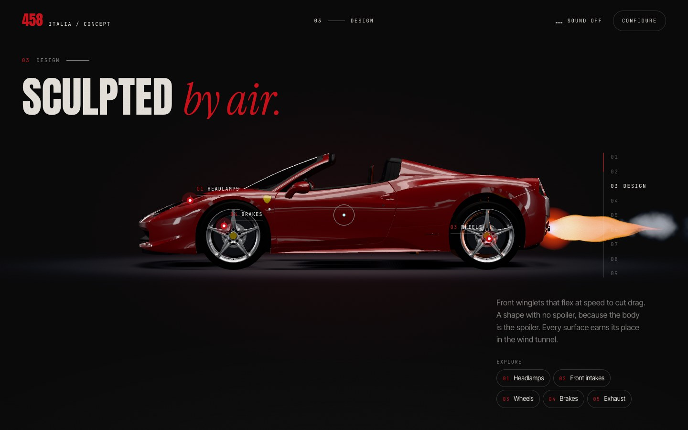
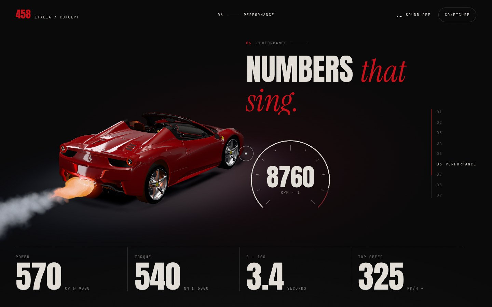

# Exhaust: flame, crackle and the limiter

Code: `src/fx/exhaust.js`, cues in `src/main.js` (Performance, Launch) and
`src/hero-intro.js` (the ignition), the camera kick in `src/experience.js`, and
the pop sound in `src/engine-sound.js`.

| | |
|---|---|
|  |  |

All of it comes out of the 458's three real tailpipe tips (measured anchors in
the vehicle registry).

## Layers

| Layer | What it is |
|---|---|
| Smoke and heat | 1,300 pooled particles in one draw call (40 % with reduced motion), simulated in world space. A brief hot core glows; a cool blue-grey haze rises, slows and spreads |
| Flame | One flame body per pipe (a lathe mesh with a procedural shader): blue at the nozzle, white-gold, a long orange body and a ragged red tip, with turbulence travelling outwards. It lives about 0.15 s per bang. At the limiter, a small blue flame flickers continuously |
| Light | A point light at the tips flashes with each bang (it lights the diffuser, bumper and rear wheels), plus an additive halo at each tip |
| Haze | The heat-shimmer plume behind the tips grows with load and with every bang |

## Events

- `pulse(strength)`: one bang (ignition, an upshift, a touch of the limiter).
- `crackle(duration, amount)`: the overrun, a volley of irregular pops as the revs fall.
- `onPop(fn)`: every bang is reported. The page uses it for a camera kick (scaled
  by distance, so close-ups and wide shots read alike) and, with sound on, an
  audible pop (a band-passed crack over a low thump) through the engine voice.

## Where it fires

| Chapter | Cue |
|---|---|
| Intro | Ignition bang, a blip, then the overrun crackle (see `docs/HERO-INTRO.md`) |
| Performance | Load follows the revs. Each crossing of the limiter bangs; while the revs are held there it keeps bouncing off it every 110–190 ms, even if the visitor stops scrolling. Backing off below 7,600 rpm, or leaving the chapter hot, crackles |
| Launch | A bang at launch, then a bang and a short crackle on every upshift, the plume swept back by the airflow |

## Notes

- The flame shader writes its intensity in alpha: three.js additive blending
  weights the colour by source alpha, so writing alpha 0 renders nothing.
- Flame brightness is kept below the tone-mapping knee (×1.45), so the colours
  stay saturated instead of washing out to pink-white where the three flames overlap.
- Reduced motion: no flame, no crackle and no kick; a bang is a soft light flash only.
