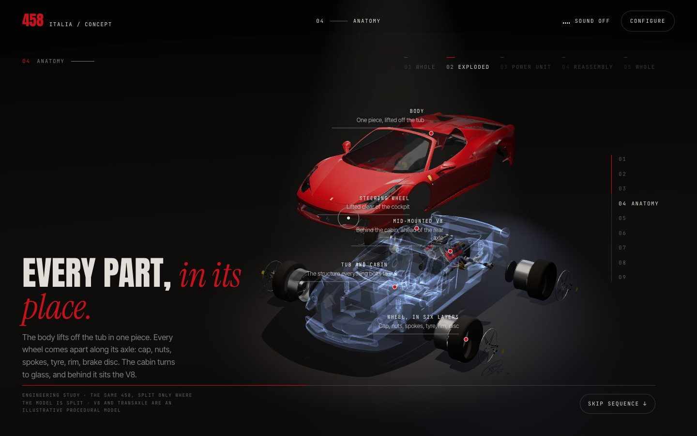
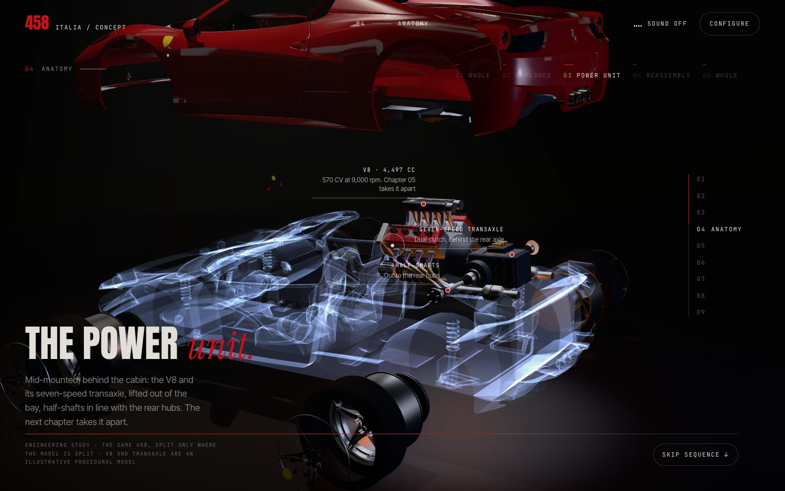

# Exploded view: the Anatomy chapter

Code: `src/cinematic/timeline.js` (states, channels, lights, camera keys),
`src/cinematic/controller.js` (playhead owner), `src/cinematic/exploder.js`
(posing), `src/cinematic/manifest.js` (parts and annotations),
`src/cinematic/anatomy.js` (stage), and the wiring in `src/main.js`
(`anatomyFrame`, `goToAnatomyState`).

| | |
|---|---|
|  |  |

## One car, everywhere

The chapter takes apart **the same Ferrari 458** the rest of the site shows: the
same file, the same look-dev materials slot for slot, and the visitor's own
paint and wheel finish from the Atelier (the stage copies the main car's live
paint and rim materials every frame). The earlier stand-in concept car is gone,
along with its 1.6 MB download.

The 458 file is split by material, not by panel, so it is taken apart only where
it really is separate. Nothing is cut or invented:

- **The body** (shell, glass, lamps, trim, badges, wipers) is one piece, so it
  lifts off the tub as one piece.
- **The wheels** are genuinely separate, so each corner comes apart along its
  axle in six real layers: centre cap, nuts, spoke face, tyre, rim barrel and
  brake disc.
- **The steering wheel** is its own group, and rises out of the cockpit.
- **The tub and cabin** stay. They turn to glass while the car is apart, which
  shows the structure the asset really contains (frame members and coil springs
  are part of the tub mesh) and the engine bay.
- **The engine** is the procedural V8 and transaxle from the Engine chapter
  (`src/engine/v8.js`), mounted where a 458's engine sits, at 1:1 scale: behind
  the cabin, the differential on the measured rear-axle line (z 1.495), and the
  half-shafts at hub height (y 0.358), reaching the hubs at x ±0.82. Inside the
  closed body it is hidden. Once the body lifts, it is there.

The copy and credit line say which parts are the model's own and that the engine
is illustrative.

## States

One timeline, indexed by a playhead `q` (0..1) that matches the section's scroll
progress. Parts, lights, glass and camera are pure functions of `q`.

| # | State | Anchor | What happens |
|---|---|---|---|
| 1 | Whole | q 0.10 | The room's lights come up on the assembled car |
| 2 | Exploded | q 0.45 | The body lifts 2 m (explode 0.00–0.36), the steering wheel rises, and the four corners come apart in turn. The tub turns to glass (0.30–0.40). Held and annotated |
| 3 | Power unit | q 0.66 | The V8 and transaxle lift 0.62 m out of the rear bay through the glass deck (power channel, 0.50–0.62). Low rear three-quarter camera. Held and annotated |
| 4 | Reassembly | q 0.86 | Engine back, glass solid again (0.74–0.80), then everything returns in reverse order |
| 5 | Whole | q 0.95 | The assembled car in the final composition, then the hand-over to the Engine chapter |

## Control: one playhead, two inputs

`SequenceController` is the only thing that moves `q`. It has two inputs, and
only one is active at a time:

- **Scroll:** `q` follows section progress with light damping (λ = 7). Scrolling
  backwards replays the same paths in reverse.
- **State buttons:** one GSAP tween plays the authored sequence from `q` to the
  state's anchor (power2.inOut, 0.7 s plus 3.6 s per unit of distance, capped at
  3.2 s), forward or in reverse through the real choreography. When it starts,
  the page jumps to the anchor, so scroll and playhead agree when it ends.

| Situation | Behaviour |
|---|---|
| Scroll during a state tween | The tween stops where it is. `q` eases to the new scroll position |
| Second press on the playing state, or `Esc` | Completes it at once |
| *Skip sequence* | Completes any tween, then scrolls to the Engine chapter |
| Re-entering the chapter (from either end, or after a jump) | Happens under the hand-over curtain. `q` is put on the scroll position, so the sequence is never replayed on the way in |
| Reduced motion | State buttons cut straight to the state |
| Model not loaded yet | `q` still tracks scroll. The loading notice shows, and posing starts once the model is ready |

## Transforms

- Motions are authored in **458 model space**: Y up, metres, nose towards −Z,
  the car's left towards −X. The stage turns the model 180° so its camera keys
  keep "az 0 = in front of the nose".
- At load, each moving node is re-parented onto the model root with its world
  transform kept (`Object3D.attach`), so its path no longer depends on a parent.
  The wheel layers are children of the wheel node in the file, but each leaves
  on its own path.
- Each pose is rebuilt from the stored rest matrix: `M = T(move·k) · T(pivot) ·
  R(axis, angle·k) · T(−pivot) · Rest`. At `k = 0` the stored rest values are
  copied back exactly.
- The V8 is not a registry component, so it is passed to the exploder as an
  extra (`'@v8'`) and moves on the same terms.

## Parts and motions

| Part | Components | Channel / window | Motion |
|---|---|---|---|
| Body | `body.*`, `glass.main`, `lights.*` | explode 0.00–0.36 | Up 2.0 m |
| Steering wheel | `interior.steering` | explode 0.28–0.56 | Up 0.82 m |
| Wheel layers ×4 corners | `wheel.<c>.cap / nuts / spokes / tire / barrel / disc` | explode, corner starts 0.30 / 0.33 / 0.36 / 0.39, layers 0–0.10 apart, each 0.26 long | Out along the axle: cap 1.58, nuts 1.46, spokes 1.30 (turning 30°), tyre 1.02 (turning 40°), rim 0.72, disc 0.36 m |
| V8 and transaxle | `@v8` | power 0.00–0.85 | Up 0.62 m, tipped 4° |

**Why they don't collide.** The body is clear of the tyres before any wheel
moves (the arches clear the tyre tops at a lift of about 0.7 m). On each corner,
the outermost layer leaves first and every layer travels further than the one
inside it, so each passes out through the bore of the next. The spoke face fits
inside the tyre, and the gap between barrel and tyre at the end equals the barrel
width. The engine lifts only once the body is 2 m up, and passes through the
rear deck only while the tub is glass.

## Camera and light

- Camera keys name the point set they frame (the assembled car, the exploded set
  or the lifted engine). Both the target (the set's centre) and the distance
  (per aspect ratio, `fitDistance`) are solved, never authored, so the keys
  survived the change of car unchanged in spirit.
- The power-unit shot is a low rear three-quarter (az 112–128°, 24° lens).
- Lights follow the playhead as before. The warm "bay" light sits at the
  engine's rest position, and a cool top light follows it as it lifts.
- **Glass:** the tub, cabin panels, leather, carpet and carbon fade to 10 %
  opacity and gain the Engine chapter's fresnel x-ray shell (at 55 %). The
  shader variants are compiled at load, so the first glass frame doesn't stall.

## Annotations

Shown only while a state is held. Each names a real part and says only what is there:

- **Exploded:** body ("one piece, lifted off the tub"), wheel in six layers,
  mid-mounted V8, steering wheel, tub and cabin.
- **Power unit:** V8 (4,497 cc, 570 CV), seven-speed transaxle, half-shafts. The
  markers sit on points of the engine (`at`, in rest model space), so they travel
  with it.

A label whose marker leaves the frame is hidden rather than left hanging.

## Tests (headless Chrome, Apple M2 via ANGLE/Metal)

| Test | Result |
|---|---|
| Three runs of real wheel scrolling through the whole film and back out of the top, then re-entry | Every part at its stored rest transform (max deviation 1.1×10⁻¹⁶ m, float noise; `exact` true) |
| Whole-page wheel scroll down and up | No console errors. Stages released, curtain clear |
| Frame time | 16.5 ms in every state at 1440×900 (about 215 draw calls, 760k triangles with the engine and shadows) |

Note: if the visitor scrolls out of the chapter faster than the damped playhead
follows, the off-screen pose freezes wherever the playhead was. It is never seen,
because re-entry always happens under the curtain and puts the playhead on the
scroll position first.
