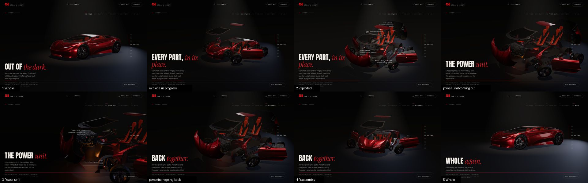
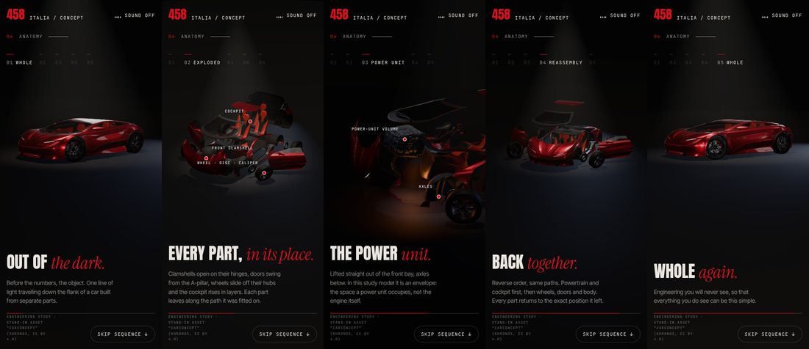

# Exploded view: the Anatomy chapter

Code: `src/cinematic/timeline.js` (states, channels, lights, camera keys),
`src/cinematic/controller.js` (playhead owner), `src/cinematic/exploder.js`
(posing), `src/cinematic/manifest.js` (parts and annotations),
`src/cinematic/anatomy.js` (stage), and the wiring in `src/main.js` (`anatomyFrame`,
`goToAnatomyState`, `layoutCallouts`).

## Which model, and why

The hero car (`ferrari.glb`, registry `ferrari-458`) **cannot support an exploded
view**. Its exterior is one mesh, and so are its glass, its interior and its
tub. Only the four wheel assemblies and the steering wheel are separate. Splitting
it arbitrarily would mean inventing parts, so it is not done.

The sequence uses the component-separated stand-in model already in this
chapter (`concept-car.glb`, Khronos "CarConcept", CC BY 4.0, registry
`khronos-carconcept`). Its panels are separate nodes whose origins are their real
hinges and hubs (checked against the registry at load). The page credits it as a
stand-in.

## States

One timeline, indexed by a playhead `q` (0..1) that matches the section's scroll
progress. Parts, lights and camera are pure functions of `q`.

| # | State | Anchor | What happens |
|---|---|---|---|
| 1 | Whole | q 0.10 | The room's lights come up on the assembled car (0–0.10) |
| 2 | Exploded | q 0.45 | Explode channel 0→1 (0.14–0.40), then a held, annotated view |
| 3 | Power unit | q 0.66 | Power channel 0→1 (0.50–0.62): the powertrain comes out and the camera moves in. Held and annotated |
| 4 | Reassembly | q 0.86 | Powertrain back (0.70–0.77), then explode 1→0 in reverse order (0.77–0.92). The anchor is mid-way: powertrain and cockpit installed, wheels going on, body still open |
| 5 | Whole | q 0.95 | The assembled car in the final composition, then the hand-over to Performance |

There are two channels so that the power unit moves only once the body is open:

- `explode`: glass, wheels and brakes, doors, clamshells, cockpit
- `power`: the power-unit volume and the axles

## Control: one playhead, two inputs

`SequenceController` is the only thing that moves `q`. It has two inputs, and
only one is active at a time:

- **Scroll:** `q` follows section progress with light damping (λ = 7). Scrolling
  backwards replays the same paths in reverse.
- **State buttons:** one GSAP tween plays the authored sequence from `q` to the
  state's anchor (power2.inOut, 0.7 s plus 3.6 s per unit of distance, capped at
  3.2 s). It plays forward or in reverse through the real choreography, never as
  a straight-line blend, so parts always travel their collision-checked paths.
  When the tween starts, the page jumps to the anchor, so scroll and playhead
  agree when it ends and control returns to scroll with no jump.

Edge cases:

| Situation | Behaviour |
|---|---|
| Scroll during a state tween | The tween stops where it is. `q` eases to the new scroll position |
| Second press on the playing state, or `Esc` | Completes it at once |
| *Skip sequence* | Completes any tween, then scrolls to Performance |
| Re-entering the chapter (from either end, or after a jump) | Happens under the hand-over curtain. `q` is put on the scroll position, so the sequence is never replayed on the way in |
| Reduced motion | State buttons cut straight to the state |
| Model not loaded yet | `q` still tracks scroll. The loading notice shows, and posing starts once the model is ready |

Nothing else writes part transforms, so scroll and clicks cannot fight.

## Transforms

- Motions are authored in **model space** (the vehicle root's frame: Y up, nose
  +Z, left +X, metres).
- At load, each moving node is re-parented onto the vehicle root with its world
  transform kept (`Object3D.attach`). Its rest transform is then in model space,
  and its path no longer depends on a parent that may itself move. In the file,
  the brake disc and caliper are children of the wheel, but they leave on their
  own path.
- Children that are not listed stay with their parent: door glass and mirror in
  the door, headlamps in the front clamshell, tail-lamps and rear glass in the
  rear clamshell.
- Each pose is rebuilt from the stored rest matrix: `M = T(move·k) · T(pivot) ·
  R(axis, angle·k) · T(−pivot) · Rest`. Nothing accumulates. At `k = 0` the
  stored rest position, quaternion and scale are copied back exactly.

## Parts and motions

| Part | Registry components | Channel / window | Motion |
|---|---|---|---|
| Roof panel | `body.roof` | explode 0.00–0.24 | Up 1.30 m |
| Windscreen | `glass.windshield`, `…gasket`, `body.wipers` | explode 0.04–0.30 | Up 1.15 m, forward 0.80 m: a canopy over the cockpit and the power-unit column |
| Wheels ×4 | `wheel.fl/fr/rl/rr` | explode 0.08–0.38 (staggered) | Out 1.0 m along the axle line, turning 35° about it |
| Disc + caliper ×4 | `wheel.*.disc`, `wheel.*.caliper` | explode, 0.04 after their wheel | Out 0.42 m, so each corner reads hub → brake → wheel |
| Doors | `panel.door.left/right` | explode 0.20–0.48 | Swing 58° on the A-pillar hinge, then 0.70 m out and 0.15 m back |
| Front clamshell | `panel.frontClamshell` | explode 0.30–0.58 | Tilts 64° forward on its nose hinge, then up 0.3 m and forward 0.5 m |
| Rear clamshell | `panel.rearClamshell` | explode 0.34–0.62 | Tilts 58° back on its tail hinge, then up 0.3 m and back 0.5 m |
| Steering assembly | `interior.steering` | explode 0.50–0.76 | Up 0.98 m, back 0.16 m (it goes first: its column runs through the dashboard) |
| Seats | `interior.seats` | explode 0.54–0.80 | Up 1.00 m, back 0.38 m |
| Dashboard | `interior.dash` | explode 0.60–0.86 | Up 0.42 m |
| Pedal box | `interior.pedals` | explode 0.66–0.92 | Up 0.20 m, back 0.42 m |
| Power-unit volume | `powertrain.engine` | power 0.00–0.85 | Straight up 1.05 m out of the front bay, forward 0.22 m, tipped 6° |
| Axles | `chassis.axles` | power 0.25–1.00 | Down 0.20 m |

Wheels come off before the clamshells open, so no wheel arch sweeps through a
tyre. Reassembly runs the same windows in reverse: powertrain, then dashboard,
seats and steering, then clamshells, doors, wheels, and finally the glass.

**Collision check.** Every pair of moving parts was sampled at 31 poses along both
channels (21 on the explode channel, 10 on the power channel), comparing per-mesh
world bounds and counting only overlap beyond what the pair already shares when
assembled. In the exploded and power-unit poses, no moving parts share space. In
motion, the remaining box overlaps are:

- the doors' swept bounds against the rear clamshell as they swing;
- the axle set against the dashboard and the pedal box (one mesh spans both
  axles, so its box covers the whole cabin floor);
- a 1.3-litre transient between steering and seats.

Bounding boxes can't confirm or rule out contact at triangle level, so these were
checked by eye in the rendered frames.

## Camera and light

- Camera keys come from the same system as the main car: orbit keys on the
  monotone spline (`scene/spline.js`, shared with the hero intro), with distances
  solved per aspect ratio by `fitDistance`. Each key frames a measured point set:
  every mesh's bounds in the assembled pose, the exploded pose, or the extracted
  power unit.
- On wide screens the subject sits right of the copy. On tall screens it sits
  above it.
- The camera opens wide to hold the whole exploded set. For the power unit it
  moves to a low side view at about 8 m (desktop) with a 24° lens, so the lifted
  volume reads against the dark, between the open clamshell and the windscreen.
- Reflections come from the studio environment used for the main car
  (`lookdev/studio.js`), held low and brought up with the lights.
- Light levels follow the playhead: the reveal, an even "study" light on the
  exploded view, a cool top light on the power unit, and a rim light for the
  final shot. The warm light in the empty bay is just a light.
- The earlier engine vibration and heat-haze shimmer were removed. They implied
  a running engine the model does not contain.

## Annotations

Annotations appear only while a state is held. Each names a real part and says
only what the model shows:

- **Exploded:** front clamshell, doors, wheel · disc · caliper, cockpit, rear
  clamshell.
- **Power unit:** the power-unit volume ("envelope only in this model — no engine
  internals") and the axles.

The axles marker sits on the front axle shaft (an explicit model-space point),
not at the part's box centre, which is empty space between the axles.

Overlapping labels are lifted clear on leader lines, and lifts ease rather than
jump. Phones show the key annotations only, as titles.

## Missing model parts

**For a real power-unit state (stand-in model):**

1. **Engine**, as separate nodes, each with its mounting point as origin:
   block, cylinder heads, intake plenum and runners, exhaust manifolds, ancillary
   drive. The model has an 89-vertex box with a normal map.
2. **Transmission:** gearbox or transaxle, clutch housing, and half-shafts with
   CV joints, so the driveline can come out with the engine.
3. **Exhaust system:** manifolds, catalysts, silencer, tailpipes. The model has
   none, so no exhaust is shown in this chapter.
4. **Engine and gearbox mounts**, so the lift starts from real mounting points.

**For a fuller mechanical exploded view (stand-in model):**

5. **Suspension per corner:** upper and lower wishbones, upright or hub carrier,
   spring/damper unit, anti-roll bars. Today the wheel moves off a bare hub.
6. **Steering rack and tie rods.**
7. **Axles as two separate nodes** (front and rear). Today one mesh spans both,
   with simple cylinders.
8. **Separate left and right seats.** Today one component holds both, split by
   material.
9. **Separate front and rear bumpers.** Today they belong to the clamshells.
10. **Cooling** (radiators, fans) and the **fuel tank**.

**To explode the hero 458 itself:** a component-separated model with separate
bonnet, engine cover, doors, front and rear bumpers, wings, glass (windscreen
apart from the headlamp covers), seats and dashboard, each with hinge or mounting
origins, plus items 1–6 above. The current file has none of these (see
`docs/LOOKDEV.md` and `docs/ASSETS.md`).

## Tests (browser, software renderer)

All of these were run in headless Chromium against the dev server. Every one passed.

| Test | Result |
|---|---|
| Scroll forwards, then backwards, through the section in 5 % steps with real smooth scrolling | At every step the pose equals the pure function of the playhead. Both runs end with every part at its stored rest transform, bit-exact |
| 10 full runs, alternating scroll and the state buttons | Every node is back at its stored rest values, bit-exact. Model-space deviation from the exported pose is 9×10⁻¹³ m (matrix decomposition noise) |
| All 20 state-to-state transitions via the buttons | Each lands on the state: playhead, page position, copy, active button and pose |
| Second press on the playing state, `Esc`, keyboard (focus + Enter) | Complete at once, and work from the keyboard |
| Scroll mid-tween | Control returns to scroll and the pose stays consistent. A button still works afterwards, and parts return exactly |
| *Skip sequence* | Lands on Performance with the stage released and no curtain left |
| Leave and re-enter four times, including jumps straight into the end of the section | The playhead lands on the scroll position (no replay), parts at rest |
| Reduced motion | A button cuts straight to the state |
| Phone (390×844) | All five state buttons on screen and tappable, sequence works |
| Console | No errors in any run |

**Performance:**

- **Scene:** 185–217 draw calls and 378k–427k triangles, shadow pass included.
  The per-frame cost of posing, camera and lights is 0.015–0.018 ms.
- **Load:** framing measurements take about 15 ms, once. Camera distances for a
  new aspect ratio take about 10 ms, solved under the hand-over curtain.
- **Memory:** the studio environment is shared with the main scene, so there is
  no second cube capture.
- **Not measured:** frame rate on a real GPU. The session only had a software
  renderer, where this scene takes seconds per frame.
