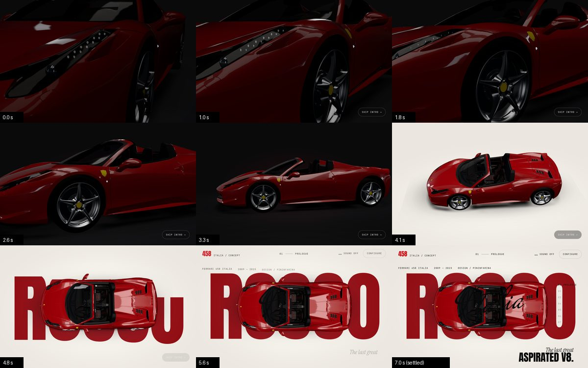
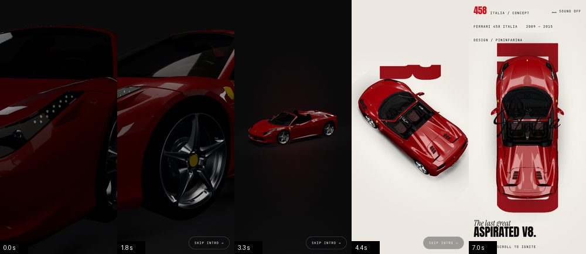

# Hero intro: the opening shot

Code: `src/hero-intro.js` (timeline, camera path, skip, modes); hooks in
`src/experience.js` (`rigLambda`, `parallax`, `setStudio`) and `src/main.js`
(`setTheme`, scroll hand-over).

Frames seeked from the running timeline (960×600 and 390×844, software renderer):

## The shot (5.2 s of camera, settled by 6.2 s)

| Time | Camera | Light and page | Type |
|---|---|---|---|
| 0.0 s | Close on the left headlamp's LED strip, 1.25 m away (1.95 m on phones) | Dark studio: environment at 10 %, reflections rotated 1.5 rad | None. *Skip intro* fades in at 0.4 s |
| 0.0–1.8 s | Tracks back along the strip, over the front wheel arch | Studio up to 24 %. The reflections start sweeping across the panels | — |
| 1.8–3.3 s | Pulls back down the flank (desktop) or to a fitted front three-quarter (phones) | Studio up to 55 % | — |
| 3.3–5.2 s | Rises over the car into the top-down hero poster and decelerates to rest | Studio to 100 %, reflections back at rest by 3.6 s. Page turns carbon → paper at 3.9 s (1.4 s cross-fade) | *Skip intro* fades out at 4.6 s |
| 4.3 s | (decelerating) | — | **ROSSO** rises letter by letter, masked from below |
| 4.9 s | at rest from 5.2 s | — | *Italia* signature writes on, left to right |
| 5.3–6.2 s | — | — | Navigation, then hero copy, chapter rail, and finally the scroll cue |

Type starts only once the camera is decelerating, so text and camera never
compete for attention.

## How it stays smooth and jump-free

- **One GSAP timeline owns everything**: camera, studio light, theme, type,
  navigation and the skip control. Any moment of the intro is a function of the
  timeline's time, so seeking, skipping and reduced motion all land on the same
  final frame.
- **Camera keys live in car space.** They are converted to the scroll rig at run
  time, and the last key *is* the live hero keyframe the scroll system uses. The
  intro's final frame and the first scroll frame are therefore identical, which
  the tests confirm to 0.001.
- **Monotone Hermite spline.** Tangents are the harmonic mean of the neighbouring
  slopes, so no channel overshoots its keys. The camera never dips below a key's
  height or swings past an angle and back. Both ends are at rest, and the dolly
  runs in log space so perceived speed stays even.
- While the intro runs, the rig's damping is off (`rigLambda = Infinity`): the
  timeline drives the camera exactly. Pointer parallax is off too
  (`parallax: 0`). Afterwards normal damping returns. The top-down hero keeps a
  gentle 30 % pointer response on fine-pointer desktops only, because yaw there
  rotates the whole image.
- **Scroll is held** (`lenis.stop()`) until the shot settles. Any attempt to
  scroll skips instead of fighting the camera.

## Skip, revisit, accessibility

| Situation | Behaviour |
|---|---|
| *Skip intro* button, `Esc`, wheel, touch-drag, `Space`/`↓`/`PgDn`/`End` | 0.25 s fade to black, cut to the settled hero, 0.6 s fade back. It never fast-forwards through the flight. Ignored in the last 8 % |
| Orientation change mid-intro | Skips (the shot is composed per orientation) |
| Second load in the same tab session | Short version: starts at the wide shot (3.0 s) at 1.15× speed. The camera settles in about 2 s and everything else by about 3.5 s |
| `prefers-reduced-motion: reduce`, or no WebGL | No camera flight. The final composition, with 0.6 s opacity fades only |
| Deep link (`/#configure`) | No intro. The page opens at that section |
| Reload | Scroll restoration is manual and the page starts at the top, so the intro never plays over a restored mid-page scroll |
| Returning to the top later | ROSSO and *Italia* are back exactly as settled. The scroll-out scrub uses explicit start values |

The skip button is a real `<button>` with a visible focus ring. Keyboard skips
are ignored while focus is on the button, so `Space` doesn't fire twice.

## Framing per device

- **Landscape:** the detail at 30° fov, then a side pull-back, then a rise to the
  top-down poster (car yawed 90°).
- **Portrait:** a wider opener (36° fov), then a front three-quarter whose distance
  is fitted to the screen by `fitDistance`, then a rise to the portrait poster
  (car nose up). Azimuth rises the whole way (205° → 226° → 236° → 360°).
- **Short landscape screens:** ROSSO is sized by height as well as width
  (`min(41vw, max(62vh, (100vh − 380px) / 0.875))`). Below 840 px tall the hero
  paragraph steps aside, as it already does on phones, so the word is never hidden
  by the car or printed over the copy.

## Measured (software renderer; camera path sampled at 60 Hz)

| | Desktop 1152×720 | Phone 390×844 |
|---|---|---|
| Closest approach to the car's bounding box | 0.43 m | 1.14 m |
| Peak camera speed | 9.6 m/s | 30.7 m/s (the pull-back from 2.3 m to the fitted wide shot) |
| Peak azimuth rate | 24°/s | 95°/s (rising over the car to nose-up) |
| Frame-to-frame jumps in speed | none (max 6 mm) | none (max 24 mm) |
| Timeline end vs settled scroll rig | identical | identical |

These are not real-device numbers. Frame pacing was not measured on a GPU.

## Known limits

- **Phone hero composition** (unchanged from before this task): the vertical
  ROSSO is about as wide as the top-down car, so the car covers most of it and
  only its edges show. Fixing it needs a different mobile hero layout (smaller
  car, or the word moved off the car), which is a design decision.
- The opening close-up relies on the model's DRL strip and smoothed bodywork.
  There is no texture detail to show (see `docs/LOOKDEV.md`).
