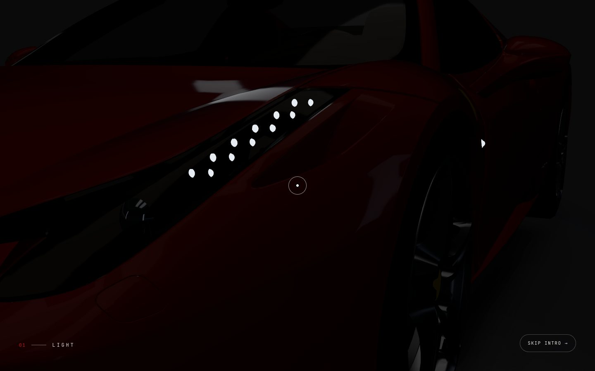
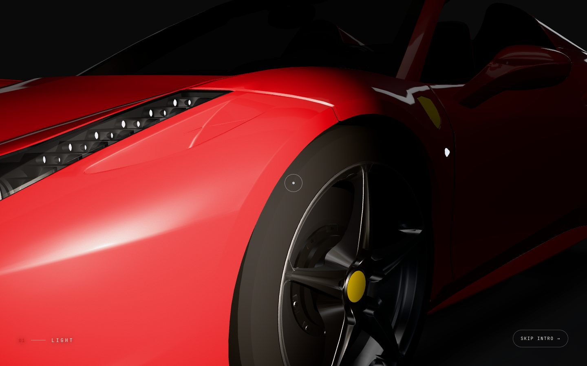
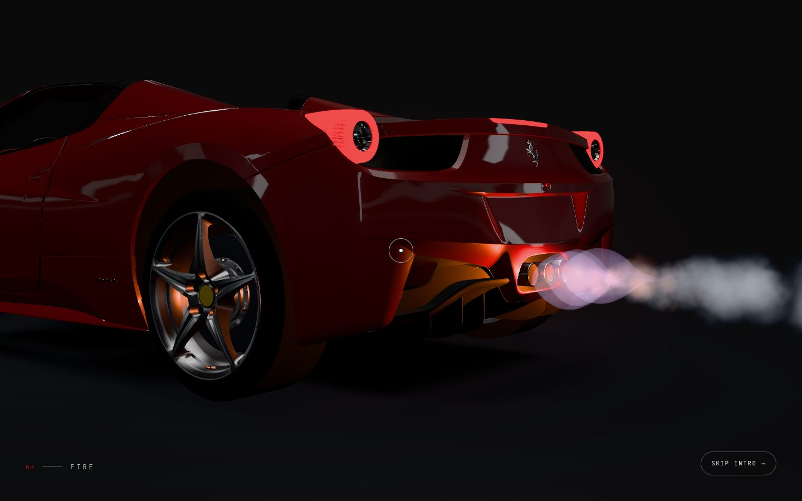
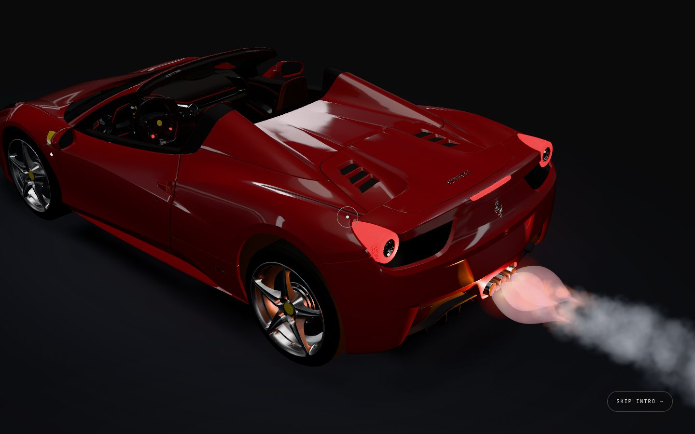

# Hero intro: the opening film

Code: `src/hero-intro.js` (timeline, camera path, captions, skip, modes); hooks
in `src/experience.js` (`setLamps`, `setRake`, `setStudio`, `rigLambda`,
`parallax`) and `src/main.js` (`setTheme`, scroll hand-over); the exhaust in
`src/fx/exhaust.js` (see `docs/EXHAUST.md`).

| | |
|---|---|
|  |  |
|  |  |

## The film (9.0 s of camera, settled by about 10.3 s)

Five beats on the one 458, each with its own light. Small film captions name the
first three.

| Time | Beat | Camera | Light, car and page |
|---|---|---|---|
| 0.0–0.75 s | **Dark** | Close on the left headlamp, 1.6 m out | Nothing on: studio 0, lamps off. *Skip intro* fades in at 0.4 s |
| 0.75–1.6 s | **01 Light** | Slow push-in to 1.2 m | The LED signature wakes in steps (2.6 → 0.1 → 2.9 → 0.35 → 3.3), like a real start-up sequence, then settles. It is the only light in the room |
| 1.6–4.0 s | **02 Line** | Tracks back over the front arch and along the strip | A raking spotlight travels nose to tail down the flank (car-space z −3.2 → 3.4) and draws the shoulder line. The studio starts to glow (0.05 → 0.2) and its reflections begin to sweep |
| 4.0–5.9 s | **03 Fire** | Glides down the flank to a low rear three-quarter, tailpipes in frame with room behind | Tail-lamps up. **Ignition at 4.65 s**: a bang from the three tailpipes (flame, light flash on the diffuser, camera kick, heat haze), a blip at 5.15 s, then the overrun crackle; idle smoke drifts until 6.6 s |
| 5.9–9.0 s | **Reveal** | A rising arc over the car (via el 46°) into the top-down poster | Studio to 100 %, lamps back to rest, carbon → paper at 7.3 s. **ROSSO** at 7.5 s, *Italia* at 8.1 s, navigation 8.5 s, copy 8.6 s, scroll cue 9.4 s |

Type only arrives once the camera is decelerating, so text and camera never
compete for attention.

## How it stays smooth and jump-free

- **One GSAP timeline owns everything:** camera, studio, lamps, the raking light,
  the exhaust cues, theme, type, captions and the skip control.
- **Camera keys live in car space** and the last key *is* the live hero keyframe,
  so the intro's final frame and the first scroll frame are identical.
- **Monotone Hermite spline** (no overshoot, dolly in log space), damping off
  while the timeline drives the camera, pointer parallax off.
- **One-shot effects are guarded.** The bangs and crackle are `fire(...)` cues
  that do nothing during a skip or after the film ends, so jumping to the end
  never fires a burst of bangs.
- **The raking light never toggles visibility.** It stays in the scene at zero
  intensity, because adding or removing a light changes the light count and
  recompiles every material mid-page.
- **The LEDs shine through their glass.** The headlamp's smoked cover glass
  (58 % opacity) capped even a blazing LED at grey, so the LED emitters are now
  drawn after the glass. The glass writes no depth, so they still sit behind it.

## Skip, revisit, accessibility

| Situation | Behaviour |
|---|---|
| *Skip intro*, `Esc`, wheel, touch-drag, `Space`/`↓`/`PgDn`/`End` | 0.25 s fade to black, cut to the settled hero, 0.6 s fade back. No bangs fire; lamps, raking light, studio and exhaust are restored. Ignored in the last 7 % |
| Orientation change mid-intro | Skips (the film is composed per orientation) |
| Second load in the same tab session | Starts just before the ignition (4.3 s) at 1.15× speed: fire, then reveal, about 4.5 s |
| `prefers-reduced-motion`, or no WebGL | No camera flight and no fire: the final composition with 0.6 s fades |
| Deep link (`/#configure`) | No intro |

## Framing per device

- **Landscape:** 30° lens throughout the close work, rear three-quarter at
  3.3–3.6 m, then the rise to the top-down poster.
- **Portrait:** a wider 36° lens, the Fire beat from further back and more
  directly behind (az 318–338°, 5.4–5.8 m) so the pipes and the flame fit a tall
  frame, then the rise to the portrait poster (fitted to the screen).

## Tests (headless Chrome, Apple M2)

| Test | Result |
|---|---|
| Frames seeked at 0.5–9.5 s, 1440×900 and 390×844 | Each beat composed as intended; no page errors |
| Skip from inside the Light beat | `done`, no flash or flame fired, throttle 0, DRL 0.55, tail 0.12, rake 0, studio 1, camera on the hero keyframe (el 89.4°, dist 9.6) |
| Full-page behaviour suite after the intro | No console errors |
