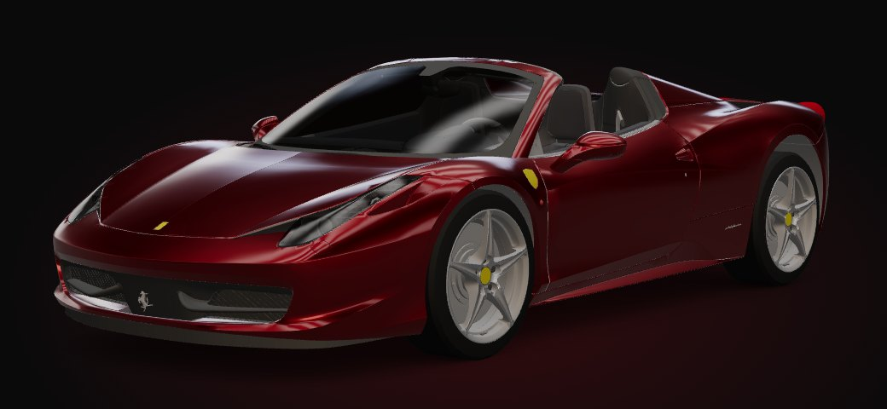
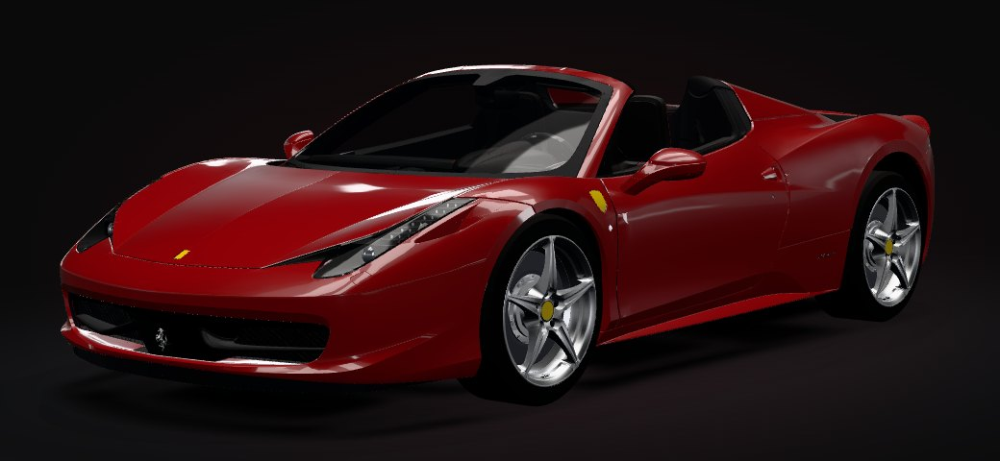

# Look development — main car

How the 458 is lit, shaded and framed, and what the source model limits.
Code: `src/lookdev/studio.js`, `src/lookdev/materials.js`, `src/scene/views.js`;
slots: `src/vehicle/registry/ferrari-458.js`.

| Before | After |
|---|---|
|  |  |

## Lighting: an image-based dark studio

The car has **no real-time lights**. One captured environment does the work, so
lighting costs nothing per frame. It is rendered once at 512 px per cube face in
half-float on desktop (256 px on touch devices), then PMREM-filtered. three r170's
`PMREMGenerator.fromScene` is fixed at 256 px, which visibly softened the
clearcoat on large screens.

| Element | Role | Setup |
|---|---|---|
| Key | Draws roof, bonnet and shoulder lines | Twin overhead strips (1.5 × 9.5 m, ×5.5) over a broad dim panel (×0.55) that grades the top surfaces |
| Rim | Separates the silhouette from the black page from any camera angle | Four tall corner strips (0.6 × 4.4 m, ×9) |
| Horizon | The line that runs down the flanks and makes curvature readable | Narrow band in the cyclorama + two long low strips at sill height |
| Fill | Detail in tyres, grilles and cabin without flattening the paint | Two broad dim cards, front ×0.3 / rear ×0.18 (the rear is lower so the flat tail panel doesn't flare) |
| Floor | Lower surfaces reflect a floor, not a void | Dark gradient in the lower hemisphere |

Colour is neutral: a faint warm key against faintly cool strips, with no coloured
lights. The page's red backdrop glow was reduced from 22 % to 10 %, so the car
no longer sits in red haze.

**Tone mapping:** Khronos PBR Neutral at exposure 1.0, replacing ACES Filmic. ACES
pushes saturated reds toward orange and pink; Neutral keeps Rosso red and white
paint unclipped. It is renderer-wide, and the Anatomy chapter was re-checked under it.

## Ground contact

- **Contact shadow, baked from the geometry** at load: the car's depth from below
  (orthographic, 1.1 m deep) becomes darkness, blurred at two radii. A tight 1024²
  layer gives the tyre contact patches and sill line; a broad 512² layer gives the
  soft occlusion under the body. It is parented to the car, follows its yaw, and
  costs nothing after load. It replaces the old 256 px AO image, which is deleted.
- **Floor light pool**: a neutral elliptical pool under the car that adds light
  without touching canvas alpha. It reads on the carbon chapters and is invisible
  on the paper ones.

## Materials

The source materials are FBX2glTF defaults (metalness 0.2, roughness 0.8, no
textures) and several are **shared by unrelated parts**:
- `Tires` also covers the grilles and wipers;
- `metal_gray` covers the trim, wheel barrels, brake discs and a steering part;
- `Interior_dark` covers the door cards, wheel nuts and steering column;
- `Taillight_Glass` covers the tail-lamps and the steering wheel's shift lights.

So every look is a **slot** in the registry (component list, optionally filtered
by original material) with its own material instance. Restyling one slot never
reaches another part.

| Slot | Look | Notes |
|---|---|---|
| paint | Solid Rosso `#94050c`, metalness 0.05, roughness 0.3, clearcoat 1 / 0.018 | Keeps the configurator's paint-sweep shader. Rosso is a solid paint; the metallic swatches (Nero, Blu, Grigio) set their own metalness |
| rims | Forged alloy, metal 1, roughness 0.3 | Now covers spokes **and** barrel, so the wheel finishes recolour the whole wheel |
| rubber | `#141414`, roughness 0.88 | Separated from grilles and wipers |
| brakeDiscs / wheelNuts | Cast iron / dark steel | — |
| chrome / metalTrim / plastic / blackTrim | Mirror chrome (incl. tailpipe tips), satin aluminium, satin-black plastics, black grilles and wipers | — |
| glass | Dark smoked glass, 0.58 opacity, clearcoat, env ×1.8, no depth write | One mesh in the source: windscreen + headlamp covers |
| headLenses / drl | Clear projector lenses; DRL strip with a soft cool-white emission | — |
| tailLenses / tailUnits | Deep red glass over faintly lit red inserts | Source opacity was ignored (`transparent: false`) |
| leather / stitching / interiorPanels / tub / carpet / carbon | Black leather with red stitching, charcoal panels, black tub and arch liners, clear-coated carbon | Source had light-grey carbon and carpet and a light-grey tub showing in the wheel arches |

## Camera views

`src/scene/views.js` defines reusable named views: `hero34` (front ¾, ~60 mm,
el 6.5°), `profile` (17° long lens), `rear34`, `atelier34`, `front`. Each view
fixes angle and lens. The distance is solved from the car's measured bounds, by
bisecting until all eight projected corners fit the share of the frame a chapter
reserves (`width × height`, then `shift` slides it beside the copy). Results are
cached per aspect ratio.

Overture, Design, Performance and Atelier use these. They were checked at 1440×900,
1920×1080, 2560×1080, 820×1180 and 390×844: no clipping, and no undersized car.
The Prologue/Finale top-down poster shots, Launch and the Anatomy hand-over keep
their hand-authored keyframes.

## Performance

- Per frame, nothing new: 52–57 draw calls and 342k–359k triangles in the car
  chapters (the same range as before), with no shadow maps, post-processing or reflection pass.
- At load (one-time): a cube capture and its PMREM, plus a 1024² depth bake with
  five blur passes.
- GPU memory: the environment is about 25 MB at 512 px (desktop) or about 6 MB at
  256 px (touch devices; this is what the previous `fromScene` used). The contact
  shadows are about 5.2 MB (1024² + 512² RGBA).
- Not measured on real devices. The session only had a software renderer.

## Source-model limitations (not fixable in look-dev)

- **No textures at all**: no tyre sidewall lettering, no carbon weave, no leather grain or perforation, no brake-disc drilling. The surfaces are uniform materials.
- **No roof.** The model is open-top (the "glass" mesh is only the windscreen and headlamp covers), so it reads as a 458 Spider, and the cabin is always visible from above.
- **Glass is one mesh**: windscreen and headlamp covers can't have different tints.
- **The body is one mesh**: no panel gaps are modelled as separate parts, so paint can't vary per panel and panels can't move.
- **Interior and underbody are fused**: the tub mesh includes the arch liners and undertray, so they share one material.
- **Hard-coded Ferrari badges** in the geometry (shields, horse) are trademarks; the licence is still unverified (see `docs/ASSETS.md`).
- **Polycount spent unevenly**: 51k vertices on interior panels but 1k on each tyre. Tyres are smooth tori without tread, visible in close-ups.
